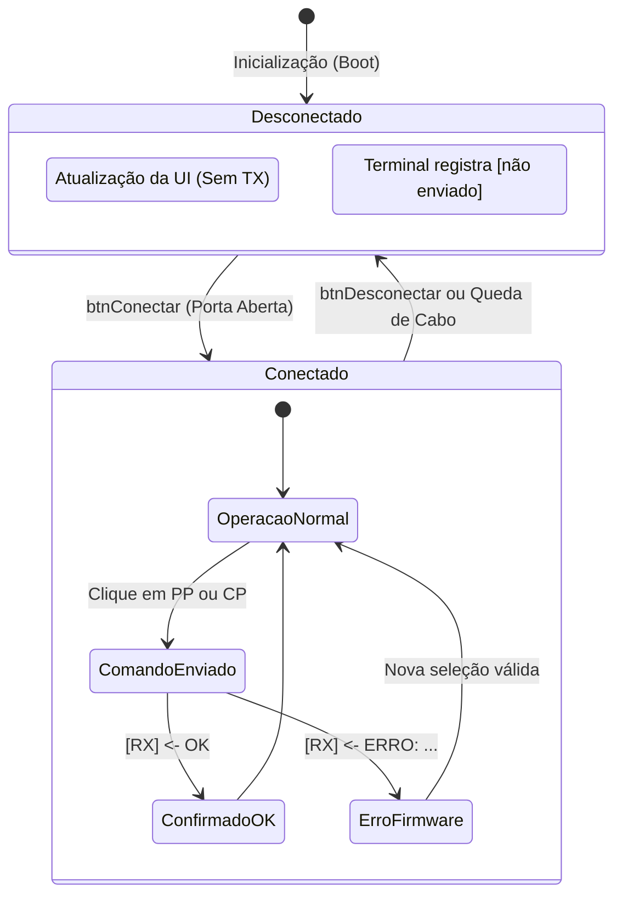

# 🎨 Especificação de Interface de Usuário: Emulador de Bancada EVSE — Piloto de Controle (CP) e Cabo (PP)

- **Documento:** Especificação de Design de UI (WinForms .NET 10 / Fluent Design)
- **Projeto:** DevSandbox — Módulo Bancada de Testes EVSE (IEC 61851-1 / IEC 62196-2)
- **Alvo:** Worktree `D:\Git\.maestri\floors\dev-sandbox--melhorias`
- **Autor:** Designer (Prisma / Antigravity)
- **Data:** 2026-11-02 (Revisão 2 — Ajuste do Usuário: Remoção do Estado F)
- **Fontes de Referência:**
  - `src/DevSandbox.UI/Forms/FormBancada.cs` e `FormBancada.Designer.cs`
  - `src/DevSandbox.UI/Common/ThemeManager.cs` e controles Fluent (`FluentButton`, `FluentCard`, `FluentToggle`)
  - `firmware/Bancada/tabela2_estados_cp.csv`
  - `audit/antigravity/2026-11-02_relatorio_estudo_bancada_cp.md`

---

## 🧭 1. Visão Geral e Princípios de Design

A janela `FormBancada` é o console operacional de emulação de veículo elétrico e cabo de recarga para validação de Estações de Recarga (EVSE) conforme as normas **IEC 61851-1** (Sinalização no Piloto de Controle — CP) e **IEC 62196-2** (Codificação de Corrente no Pino de Proximidade — PP).

### 1.1. Metas de Design
1. **Fidelidade ao Windows 11 Fluent Design (WinUI 3 Dark):** Utilização estrita dos tokens de cor e geometria definidos no `ThemeManager`, com superfícies de cartão em `#2B2B2B`, fundo de janela `#202020`, bordas sutis `#383838` (raio de curvatura 8 px), acentos em Ciano `#4CC2FF` e fontes Segoe UI.
2. **Ergonomia e Clareza Cognitiva (11 Estados Normativos):** Conforme decisão do usuário, o Estado F (−12 V) foi **completamente removido** do sistema, pois é gerado unicamente pelo EVSE e a bancada emula exclusivamente o circuito passivo do veículo. O CP passa a contar com **estritamente 11 estados** (Tabela II da IEC 61851-1), estruturados em dois níveis:
   - **Nível 1 — Estado Primário:** `A` (Desconectado), `B` (Standby), `C` (Carga Ativa), `D` (Ventilação Requerida) e `E` (Falha / Curto).
   - **Nível 2 — Variação de Tolerância (+ / Nom / −):** Exclusivo para os estados B, C e D.
3. **Preservação Rígida das Dimensões:** A interface mantém o layout em 3 colunas cabendo perfeitamente na largura atual de **840 px** e altura de **555 px** do formulário (`ClientSize = new Size(840, 555)`), sem rolagem indesejada nem corte de controles.
4. **Precisão Normativa:** Indicação visual inequívoca das tensões teóricas esperadas e anotação clara do resistor de 4700 Ω do PP (resistor específico da bancada física didática, fora da tabela padronizada da IEC 62196-2).

---

## 📐 2. Geometria Geral e Grid do Formulário (840 × 555 px)

```text
+---------------------------------------------------------------------------------------------------+
|  Bancada de Testes EVSE (IEC 61851-1 / IEC 62196-2)                                      [-] [X]  |
+---------------------------------------------------------------------------------------------------+
|  [ cardConexao: X=14, Y=12, W=812, H=68 ]                                                         |
|  PORTA SERIAL: [COM2      v] [🔄]  BAUD: [9600   v]  [ Conectar ]  (•) Conectado (COM2)           |
+---------------------------------------------------------------------------------------------------+
| [ cardCaboPP: W=256, H=420 ]     | [ cardVeiculoCP: W=256, H=420 ]    | [ cardTerminal: W=276, H=420 ]   |
| X=14, Y=88                       | X=282, Y=88                        | X=550, Y=88                      |
|                                  |                                    |                                  |
| 🔌 Emulador de Cabo (PP)         | 🚗 Emulador de Veículo (CP)        | 📟 Monitor Serial                |
| Resistores PP-PE (IEC 62196-2)   | Tensão PWM (IEC 61851-1)           | Log e Injeção UART 9600 bps      |
|                                  |                                    |                                  |
| (•) 0: Aberto (∞ Ω)              | ( ) A: Desconectado (+12 V)        | +------------------------------+ |
| ( ) 1: Desconectado (4700 Ω)*    | (•) B: Conectado / Standby (+9 V)  | | [14:20:01] Conectado COM2    | |
| ( ) 2: Cabo 13 A (1500 Ω)        | ( ) C: Carga Normal (+6 V)         | | [14:20:02] [TX] -> estado bx | |
| ( ) 3: Cabo 20 A (680 Ω)         | ( ) D: Carga Ventilação (+3 V)     | | [14:20:02] [RX] <- OK        | |
| ( ) 4: Cabo 32 A (220 Ω)         | ( ) E: Falha / Curto (0 V / 1 V)   | |                              | |
| ( ) 5: Cabo 63 A (100 Ω)         |                                    | |                              | |
| ( ) 6: Falha / Curto (47 Ω)      | +-- Variação (B, C, D) ----------+ | |                              | |
|                                  | | [ + Sup ] [• Nom •] [ - Inf ]  | |                              | |
| * Valor da bancada (fora norma)  | +--------------------------------+ | +------------------------------+ |
|                                  |                                    | [ Comando...        ] [Enviar] |
| Ativo: Circuito Aberto (∞ Ω)     | Ativo: BX Nominal (+9 V)           |                  [ Limpar ]      |
|                                  | Esperado: +8.92 V DC (8.5..9.5 V)  |                                  |
+----------------------------------+------------------------------------+----------------------------------+
| [ panelFooter: X=0, Y=520, W=840, H=35 ]                                                          |
| Emulador de Bancada Modo 3 (IEC 61851-1 / IEC 62196-2) • .NET 10                                 |
+---------------------------------------------------------------------------------------------------+
```

### 2.1. Métricas de Distribuição Horizontal
- **Margem Esquerda / Direita:** 14 px
- **Largura Útil Total:** `840 - 28 = 812 px`
- **Coluna 1 (cardCaboPP):** `Location = (14, 88)`, `Size = (256, 420)`
- **Espaçamento Coluna 1 → 2:** 12 px (`282 - (14 + 256) = 12 px`)
- **Coluna 2 (cardVeiculoCP):** `Location = (282, 88)`, `Size = (256, 420)`
- **Espaçamento Coluna 2 → 3:** 12 px (`550 - (282 + 256) = 12 px`)
- **Coluna 3 (cardTerminal):** `Location = (550, 88)`, `Size = (276, 420)`
- **Verificação da Soma Horizontal:** `14 + 256 + 12 + 256 + 12 + 276 + 14 = 840 px` (Encaixe exato).

---

## 🚗 3. Especificação Detalhada da Coluna CP (`cardVeiculoCP`)

### 3.1. Arquitetura de Seleção em Dois Níveis

Com a exclusão do Estado F, a interface atinge máxima clareza e proporção ergonômica em `cardVeiculoCP`:

1. **Nível 1 — Seletor de Estado Primário (A a E):**
   - 5 instâncias de `RadioButton` (`rbCPA`, `rbCPB`, `rbCPC`, `rbCPD`, `rbCPE`), com espaçamento vertical de 30 px, proporcionando leitura desobstruída e alinhamento visual equilibrado com a coluna de cabo PP.
   - Cada opção apresenta o código do estado, a tensão nominal de referência e o significado prático.
2. **Nível 2 — Seletor de Tolerância / Limite Operacional:**
   - Container `pnlVariacaoCP` posicionado logo abaixo dos seletores primários (Y = 225 px).
   - Contém 3 `FluentButton` compactos dispostos horizontalmente:
     - `btnVarSup` (+ Sup: Limite Superior, +1 V de offset na tensão piloto)
     - `btnVarNom` (Nominal: Tensão nominal padrão)
     - `btnVarInf` (− Inf: Limite Inferior, −1 V de offset na tensão piloto)
   - **Habilitação Condicional:**
     - Nos estados **B, C e D**, o painel de variação fica **ativo** (`Enabled = true`), permitindo testar se o EVSE sob teste reconhece as bordas de tolerância da norma.
     - Nos estados **A e E**, o painel de variação fica **desabilitado** (`Enabled = false`, opacidade reduzida e texto atenuado `#767676`), pois na norma IEC 61851-1 esses estados não possuem divisões de tolerância na bancada de ensaio do veículo.
   - **Feedback do Botão Ativo:** O botão da variação selecionada assume o modo Accent (`IsAccent = true`, fundo `#4CC2FF` e texto escuro), enquanto as variações não ativas permanecem como botões secundários (`IsAccent = false`, fundo `#383838`).

### 3.2. Tabela Canônica dos 11 Estados do CP (IEC 61851-1 Tabela II)

| Estado | Sub-variação | Tensão Nominal ($V_{CP}$) | Faixa Aceitável (IEC 61851-1) | Tensão Medida/Simulada | Relés Fechados no Mega | Comando Serial | Descrição Didática |
| :---: | :---: | :---: | :---: | :---: | :--- | :---: | :--- |
| **A** | AX Nominal | $+12\text{ V}$ | $+11{,}4\text{ V} \dots +12{,}6\text{ V}$ | $+12{,}0\text{ V}$ | *(Nenhum — S7 aberto)* | `estado ax` | Veículo desconectado (circuito aberto) |
| **B** | Superior (+) | $+10\text{ V}$ | $+9{,}5\text{ V} \dots +10{,}5\text{ V}$ | $+9{,}95\text{ V}$ | S7 (D22) | `estado bx+` | Conectado (Standby) — Limite Superior |
| **B** | Nominal | $+9\text{ V}$ | $+8{,}5\text{ V} \dots +9{,}5\text{ V}$ | $+8{,}92\text{ V}$ | S7 (D22), S9.1 (D24) | `estado bx` | Conectado (Standby) — Nominal Padrão |
| **B** | Inferior (−) | $+8\text{ V}$ | $+7{,}5\text{ V} \dots +8{,}5\text{ V}$ | $+7{,}92\text{ V}$ | S7 (D22), S9.2 (D25) | `estado bx-` | Conectado (Standby) — Limite Inferior |
| **C** | Superior (+) | $+7\text{ V}$ | $+6{,}5\text{ V} \dots +7{,}5\text{ V}$ | $+6{,}93\text{ V}$ | S7, S9.1, S10_C (D26) | `estado cx+` | Carga ativa sem ventilação — Limite Sup |
| **C** | Nominal | $+6\text{ V}$ | $+5{,}5\text{ V} \dots +6{,}5\text{ V}$ | $+5{,}92\text{ V}$ | S7, S9.1, S10_C, S11.1 (D28) | `estado cx` | Carga ativa sem ventilação — Nominal |
| **C** | Inferior (−) | $+5\text{ V}$ | $+4{,}5\text{ V} \dots +5{,}5\text{ V}$ | $+4{,}90\text{ V}$ | S7, S9.1, S10_C, S11.2 (D29) | `estado cx-` | Carga ativa sem ventilação — Limite Inf |
| **D** | Superior (+) | $+4\text{ V}$ | $+3{,}5\text{ V} \dots +4{,}5\text{ V}$ | $+3{,}91\text{ V}$ | S7, S9.1, S10_D (D27) | `estado dx+` | Carga ativa com ventilação — Limite Sup |
| **D** | Nominal | $+3\text{ V}$ | $+2{,}5\text{ V} \dots +3{,}5\text{ V}$ | $+2{,}91\text{ V}$ | S7, S9.1, S10_D, S12.1 (D30) | `estado dx` | Carga ativa com ventilação — Nominal |
| **D** | Inferior (−) | $+2\text{ V}$ | $+1{,}5\text{ V} \dots +2{,}5\text{ V}$ | $+1{,}96\text{ V}$ | S7, S9.1, S10_D, S12.2 (D31) | `estado dx-` | Carga ativa com ventilação — Limite Inf |
| **E** | Limite Sup / Curto| $+1\text{ V} / 0\text{ V}$ | $-0{,}5\text{ V} \dots +1{,}0\text{ V}$ | $+0{,}97\text{ V}$ | S7 (D22), S8 (D23) | `estado e` | Falha ou Curto CP–PE antes do diodo |

> [!NOTE]
> **Temporização de Comutação no Firmware:**
> A transição entre estados adota **tempo de espera de 20 ms**, comutando **apenas os relés diferenciais** (desliga exclusivamente os relés que saem do novo arranjo e aciona os que entram após 20 ms de acomodação), minimizando ruídos transitórios e desgaste mecânico.

---

## 🔌 4. Especificação Detalhada da Coluna PP (`cardCaboPP`)

A coluna PP emula a conexão do cabo tipo 2 (IEC 62196-2) através de 7 resistores comutados por relés para PE.

### 4.1. Opções e Resolução da Anotação do Resistor 4700 Ω

```text
[ cardCaboPP ]
+-------------------------------------------------------------------+
| 🔌 Emulador de Cabo (PP)                                          |
| Resistores PP-PE (IEC 62196-2)                                    |
|                                                                   |
| (•) 0: Circuito Aberto (Nenhum cabo)                              |
| ( ) 1: Desconectado (4700 Ω) *                                    |
| ( ) 2: Cabo 13 A (1500 Ω)                                         |
| ( ) 3: Cabo 20 A (680 Ω)                                          |
| ( ) 4: Cabo 32 A (220 Ω)                                          |
| ( ) 5: Cabo 63 A (100 Ω)                                          |
| ( ) 6: Falha / Curto (47 Ω)                                       |
|                                                                   |
| * Valor da bancada (fora da norma IEC 62196-2)                   |
|                                                                   |
| Ativo: Circuito Aberto (∞ Ω)                                      |
+-------------------------------------------------------------------+
```

1. **Anotação Obrigatória do Resistor 4700 Ω (`rbPP1`):**
   - Na IEC 62196-2, os valores normatizados de codificação de corrente de cabos são exclusivamente:
     - $1500\,\Omega \rightarrow 13\text{ A}$
     - $680\,\Omega \rightarrow 20\text{ A}$
     - $220\,\Omega \rightarrow 32\text{ A}$
     - $100\,\Omega \rightarrow 63\text{ A}$
   - A condição de plugue desconectado da norma é circuito aberto ($\infty\,\Omega$) ou chave mecânica S3. O valor de $4700\,\Omega$ é um resistor introduzido especificamente no hardware físico desta bancada didática para detecção em circuito de pull-up proprietário.
   - **Implementação Visual:**
     - O texto do `rbPP1` recebe asterisco: `1: Desconectado (4700 Ω) *`.
     - É inserido o label `lblNotaPP` logo abaixo de `rbPP6` (Y = 325 px):
       `* Valor da bancada (fora da norma IEC 62196-2)` (Fonte: Segoe UI 7.5pt Itálico, cor `#A0A0A0`).
2. **Destaque de Falha / Curto (`rbPP6`):**
   - O `rbPP6` (`6: Falha / Curto (47 Ω)`) possui cor de texto em vermelho (`#EF4444`, `ThemeManager.VermelhoPerigo`) para advertir que simula uma avaria de isolação no cabo.

---

## 📟 5. Especificação do Monitor Serial (`cardTerminal`)

O monitor serial ocupa a terceira coluna (`X=550, Y=88, W=276, H=420`) e oferece transparência total de telemetria e injeção manual de testes.

1. **Área de Exibição de Log (`txtTerminal`):**
   - **Geometria:** `Location = (14, 40)`, `Size = (248, 325)`.
   - **Estilo:** Fundo preto `#101010`, texto em verde fosforescente `#22C55E` (`ThemeManager.VerdeTerminal`), fonte `Consolas, 8.5pt`, `ReadOnly = true`, `ScrollBars = Vertical`.
   - **Prefixo Padronizado por Linha:**
     - `[HH:mm:ss] [TX] -> comando` (Linhas enviadas pelo operador ou pela UI)
     - `[HH:mm:ss] [RX] <- resposta` (Respostas recebidas do firmware)
     - `[HH:mm:ss] ⚠️ [RX] <- ERRO: ...` (Erros detectados)
     - `[HH:mm:ss] [não enviado] ...` (Tentativas offline)
2. **Linha de Injeção de Comando Manual:**
   - `txtComando`: `Location = (14, 376)`, `Size = (130, 26)`, `BackColor = #1E1E1E`, `ForeColor = #FFFFFF`, placeholder `"Comando..."`. Disparo imediato ao pressionar `[Enter]`.
   - `btnEnviar`: `Location = (150, 375)`, `Size = (58, 28)`, `IsAccent = true` (`#4CC2FF`), texto `"Enviar"`.
   - `btnLimpar`: `Location = (212, 375)`, `Size = (50, 28)`, `IsAccent = false` (`#383838`), texto `"Limpar"`.

---

## 🚦 6. Máquina de Estados Visuais e Respostas da Interface

A interface reflete 4 estados de operação de forma consistente:



### 6.1. Detalhamento dos 4 Estados Visuais

| Estado Visual | Gatilho / Condição | Comportamento dos Controles | Mensagem no Terminal | Indicador de Status (`lblStatusVeiculo`) |
| :--- | :--- | :--- | :--- | :--- |
| **1. Selecionado e Confirmado** | Conectado + Firmware respondeu `OK` | Botão/Radio ativo com acento ciano `#4CC2FF`. | `[TX] -> estado bx` <br/> `[RX] <- OK` | Texto ciano `#4CC2FF`: <br/> `Ativo: BX Nominal (+9 V)` <br/> *(Esperado: +8.92 V DC)* |
| **2. Não Enviado (Offline)** | Operador altera PP/CP com porta fechada | Rádio é checado na UI (modelo otimista local). | `[não enviado] Estado CP -> BX Nominal (9 V) (só local: sem conexão)` | Texto âmbar `#F59E0B`: <br/> `Ativo: BX Nominal (+9 V) [não enviado]` |
| **3. Desconectado** | Porta COM fechada ou conexão encerrada | `cboPortas` e `cboBaud` liberados. `btnConectar` em modo Accent (`#4CC2FF`). | `Porta serial desconectada.` | Header com LED vermelho (`#EF4444`) e texto `Desconectado` (`#A0A0A0`). |
| **4. ERRO do Firmware** | Firmware retorna linha iniciada por `ERRO` (ex.: placa Nano) | Radio selecionado mantém foco, mas o status acusa falha. | `⚠️ [RX] <- ERRO: CP indisponivel no Arduino Nano` | Texto vermelho perigo (`#EF4444`): <br/> `❌ ERRO: Rejeitado pelo Hardware!` <br/> *(Tooltip com orientação técnica)* |

---

## ⌨️ 7. Navegação por Teclado e Acessibilidade (Focus Cues & Tab Order)

A navegação pelo teclado segue as diretrizes de acessibilidade do Windows 11 Fluent Design, assegurando operação 100% via teclado:

### 7.1. Ordem Sequencial de Tabulação (`TabIndex`)

1. **Header de Conexão:**
   - `cboPortas` (`TabIndex = 0`): `[Alt+P]` ou Tab inicial. `[Setas]` selecionam a porta.
   - `btnAtualizarPortas` (`TabIndex = 1`): `[Espaço]` atualiza a lista.
   - `cboBaudRate` (`TabIndex = 2`): `[Setas]` alteram o baud rate.
   - `btnConectar` (`TabIndex = 3`): `[Enter]` ou `[Espaço]` conecta/desconecta.
2. **Coluna 1 — Cabo PP:**
   - `rbPP0` a `rbPP6` (`TabIndex = 4` a `10`): Entra no grupo via Tab. As teclas `[Seta Abaixo]` e `[Seta Acima]` alternam sequencialmente entre os resistores de 0 a 6.
3. **Coluna 2 — Veículo CP:**
   - `rbCPA` a `rbCPE` (`TabIndex = 11` a `15`): As teclas `[Seta Abaixo]` e `[Seta Acima]` alternam entre os estados A, B, C, D e E.
   - Painel de Variação de Tolerância:
     - `btnVarSup` (`TabIndex = 16`): `[Espaço]` aciona Limite Superior (+).
     - `btnVarNom` (`TabIndex = 17`): `[Espaço]` aciona Nominal.
     - `btnVarInf` (`TabIndex = 18`): `[Espaço]` aciona Limite Inferior (−).
4. **Coluna 3 — Monitor Serial:**
   - `txtTerminal` (`TabIndex = 19`): Foco no log para rolagem com `[PageUp]`/`[PageDown]` ou cópia com `[Ctrl+C]`.
   - `txtComando` (`TabIndex = 20`): Caixa de texto; `[Enter]` dispara o envio.
   - `btnEnviar` (`TabIndex = 21`): `[Espaço]` ou `[Enter]` envia.
   - `btnLimpar` (`TabIndex = 22`): `[Espaço]` limpa o buffer do terminal.

### 7.2. Indicador Visual de Foco (Focus Cues)
- Conforme implementado em `ThemeManager.DesenharFoco`, todo botão Fluent e controle customizado desenha um **anel interno de foco branco `#FFFFFF` de 2 px de espessura** com cantos arredondados quando navegado por teclado (`ShowFocusCues = true`), sumindo quando o clique é gerado pelo mouse.

---

## 💻 8. Nomes e Propriedades dos Controles WinForms (.Designer.cs)

Abaixo, a lista exata de nomes de controles, tipos e coordenadas para a implementação na `FormBancada.Designer.cs`:

### 8.1. Coluna 2 — Controles do Piloto de Controle CP
```csharp
// Card do Veículo
private DevSandbox.UI.Common.FluentCard cardVeiculoCP; // Location(282, 88), Size(256, 420)
private Label lblTituloCP;                            // Location(14, 14), Text="🚗 Emulador de Veículo (CP)"
private Label lblSubtituloCP;                         // Location(16, 36), Text="Tensão PWM (IEC 61851-1)"

// RadioButtons de Nível 1 (Estados A a E)
private RadioButton rbCPA; // Location(18, 62),  Text="Estado A (+12V) - Desconectado"
private RadioButton rbCPB; // Location(18, 92),  Text="Estado B (+9V) - Conectado (Standby)"
private RadioButton rbCPC; // Location(18, 122), Text="Estado C (+6V) - Carga Ativa"
private RadioButton rbCPD; // Location(18, 152), Text="Estado D (+3V) - C/ Ventilação"
private RadioButton rbCPE; // Location(18, 182), Text="Estado E (0V) - Falha / Curto" (ForeColor #EF4444)

// Painel de Variação de Tolerância de Nível 2
private Panel pnlVariacaoCP;              // Location(14, 222), Size(228, 64), BackColor=Transparent
private Label lblTituloVariacao;          // Location(4, 2), Text="TOLERÂNCIA (ESTADOS B, C, D):", Font=7.5pt Bold
private DevSandbox.UI.Common.FluentButton btnVarSup; // Location(4, 24), Size(68, 30), Text="+ Sup (+1V)"
private DevSandbox.UI.Common.FluentButton btnVarNom; // Location(76, 24), Size(74, 30), Text="Nominal"
private DevSandbox.UI.Common.FluentButton btnVarInf; // Location(154, 24), Size(68, 30), Text="- Inf (-1V)"

// Status e Medição Esperada
private Label lblStatusVeiculo;  // Location(16, 305), Size(224, 34), ForeColor=#4CC2FF, Font=8.5pt Bold
private Label lblTensaoEsperada; // Location(16, 345), Size(224, 55), ForeColor=#A0A0A0, Font=8pt Regular
```

### 8.2. Coluna 1 — Controles Atualizados do Cabo PP
```csharp
// Acréscimo do Rótulo de Nota Normativa na Coluna PP
private Label lblNotaPP; // Location(18, 335), Size(220, 26), ForeColor=#A0A0A0, Font=7.5pt Itálico
                         // Text="* Resistor da bancada física (fora da IEC 62196-2)."
```

---
*Especificação de UI elaborada pelo Designer (Prisma) em 2026-11-02 (Revisão 2: 11 Estados do CP).*
