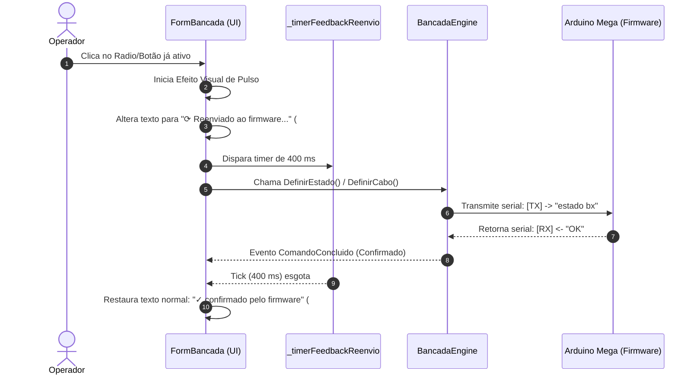

# 🎨 Especificação de Interface de Usuário: Bancada EVSE v2 — Frontend, Telemetria de Relés e Diagnóstico

- **Documento:** Especificação Técnica de UI (WinForms .NET 10 / Windows 11 Fluent Design)
- **Projeto:** DevSandbox — Módulo Bancada de Testes EVSE (IEC 61851-1 / IEC 62196-2)
- **Alvo:** Worktree `D:\Git\.maestri\floors\dev-sandbox--melhorias`
- **Arquivo Especificado:** `docs/design/bancada-v2.md`
- **Autor:** Designer (Prisma / Antigravity)
- **Data:** 2026-11-02 (Versão 2.0 — Firmware Avançado, Telemetria de Relés, Reenvio e Diagnóstico)
- **Base Técnica & Fontes:**
  - `src/DevSandbox.UI/Forms/FormBancada.cs` e `FormBancada.Designer.cs`
  - `src/DevSandbox.Core/Bancada/BancadaEngine.cs`, `RelesCP.cs`, `RespostaFirmware.cs`, `DiagnosticoStack.cs`
  - `src/DevSandbox.UI/Common/ThemeManager.cs` e controles Fluent (`FluentButton`, `FluentCard`, `FluentTextBox`)
  - `docs/design/bancada-cp.md` (Design v1 de 11 estados)
  - `firmware/Bancada/include/ConfigHardware.h` e `firmware/Bancada/src/main.cpp`
  - `audit/claude-code/2026-11-02_relatorio_app_bancada_v2.md`

---

## 🧭 1. Visão Geral e Motivação da Versão 2

A janela `FormBancada` atua como o console operacional de emulação de Veículo Elétrico (EV) e Cabo de Recarga para ensaios e validação de Estações de Recarga (EVSE) em conformidade com as normas **IEC 61851-1** (Sinalização no Piloto de Controle — CP) e **IEC 62196-2** (Codificação de Corrente no Pino de Proximidade — PP).

### 1.1. Diagnóstico da Versão 1 (Problemas Identificados)
1. **Ausência de Reenvio no Clique Repetido:** Na v1, os RadioButtons de PP e CP utilizam exclusivamente o evento `CheckedChanged`. Quando o operador clica em um estado que já se encontra marcado, nenhum evento é disparado, impossibilitando retransmitir a instrução serial ao microcontrolador (ex.: para reativar um ensaio após reiniciar o EVSE ou testar resposta a comandos idênticos).
2. **Telemetria Oculta dos Relés Físicos:** O firmware do Arduino Mega controla uma matriz de **10 relés** (D22 a D31) para montar as redes resistivas do CP e sinaliza essa composição no comando `estado status` através do campo `Reles: D30 D29 ...`. A interface gráfica não possuía nenhum indicador visual desse arranjo eletromecânico, deixando o operador sem confirmação visual do hardware real.
3. **Novas Funcionalidades do Firmware Sem Acesso na UI:** O firmware implementou comandos de diagnóstico essenciais que ainda não possuíam interface gráfica dedicada:
   - `cabo status`: leitura do estado confirmado do cabo (apenas o CP possuía botão de status na v1).
   - `debug stack`: inspeção de *watermark* de pilha das tasks FreeRTOS (`SerialCLI` e `Blink`).
   - `help`: menu interativo de comandos seriais e sintaxe.
4. **Saturação Vertical no Layout de 840 × 555 px:** Com a adição dos novos controles e do painel de relés, a altura original de 555 px tornaria a tela excessivamente densa, prejudicando a escaneabilidade e a hierarquia visual.

### 1.2. Metas de Design da Versão 2
- **Hierarquia Visual Limpa e Escaneável:** Separação funcional clara entre Conexão, Emulação de Cabo (PP), Emulação de Veículo (CP), Telemetria de Relés (Hardware) e Monitor Serial com Diagnóstico.
- **Painel de 10 Relés do CP:** Exibição gráfica dos relés D22 a D31 como LEDs industriais com nomes lógicos oficiais (`PE`, `falha`, `B-hab`, `B-sel`, `CD-hab`, `CD-sel`, `C-hab`, `C-sel`, `D-hab`, `D-sel`), acendendo em tempo real conforme a telemetria confirmada do firmware.
- **Feedback Tátil e Visual de Reenvio:** Captura de eventos `Click`/`MouseUp` nos seletores já marcados com animação de pulso ciano e texto temporário `"⟳ Reenviado ao firmware..."`.
- **Ações Rápidas de Diagnóstico:** Botões ergonômicos para `Status PP`, `Status CP`, `⚡ Debug Stack` e `❓ Help`.
- **Fidelidade Estrita ao Fluent Design (WinUI 3 Dark):** Utilização dos tokens centralizados em `ThemeManager`, com cantos arredondados, contrastes acessíveis e suporte a navegação completa por teclado via Focus Cues.

---

## 📐 2. Geometria, Dimensões e Grid do Formulário

Para acomodar o painel dos 10 relés e a barra de ferramentas de diagnóstico com folga ergonômica e conforto visual, a área cliente do formulário foi otimizada:

- **Dimensões Anteriores (v1):** `ClientSize = 840 × 555 px` (saturada).
- **Dimensões Oficiais da v2 (Recomendada):** `ClientSize = 880 × 600 px` (`+40 px` em largura, `+45 px` em altura).
- **Proporção Geral:** A largura de 880 px harmoniza perfeitamente com a janela principal `MainForm` (977 px) e com telas padrão 1080p e 720p em escala 100% ou 125%, sem demandar barras de rolagem.

### 2.1. Mockup Estrutural em ASCII Art (880 × 600 px)

```text
+-----------------------------------------------------------------------------------------------------------------+
|  Bancada de Testes EVSE (IEC 61851-1 / IEC 62196-2) — v2.0                                             [-] [X]  |
+-----------------------------------------------------------------------------------------------------------------+
|  [ cardConexao: X=14, Y=10, W=852, H=64 ]                                                                       |
|  PORTA SERIAL: [COM3      v] [🔄]   BAUD: [9600   v]   [ Conectar ]   (•) Conectado (COM3 @ 9600 bps)          |
+-----------------------------------------------------------------------------------------------------------------+
| [ cardCaboPP: W=268, H=485 ]        | [ cardVeiculoCP: W=276, H=485 ]     | [ cardTerminal: W=284, H=485 ]       |
| X=14, Y=82                          | X=294, Y=82                         | X=582, Y=82                          |
|                                     |                                     |                                      |
| 🔌 Emulador de Cabo (PP)            | 🚗 Emulador de Veículo (CP)         | 📟 Monitor & Diagnóstico             |
| IEC 62196-2 (Resistores PP-PE)      | IEC 61851-1 (Sinalização PWM)       | Telemetria Serial e Firmware         |
|                                     |                                     |                                      |
| (•) 0: Circuito Aberto (∞ Ω)        | ( ) A: Desconectado (+12 V)         | [⚡ Stack] [❓ Help]      [🗑 Limpar] |
| ( ) 1: Desconectado (4700 Ω) *      | (•) B: Conectado / Standby (+9 V)   | +----------------------------------+ |
| ( ) 2: Cabo 13 A (1500 Ω)           | ( ) C: Carga Normal (+6 V)          | | [14:20:01] Conectado COM3        | |
| ( ) 3: Cabo 20 A (680 Ω)            | ( ) D: Carga c/ Ventilação (+3 V)   | | [14:20:02] [TX] -> estado bx     | |
| ( ) 4: Cabo 32 A (220 Ω)            | ( ) E: Falha / Curto (+1 V)         | | [14:20:02] [RX] <- OK            | |
| ( ) 5: Cabo 63 A (100 Ω)            |                                     | | [14:20:02] [RX] <- [STATUS CP]...| |
| ( ) 6: Falha / Curto (47 Ω)         | +-- TOLERÂNCIA (ESTADOS B, C, D) -+ | | [14:20:05] [STACK] CLI: 180 B    | |
|                                     | | [+ Sup]    [• Nom •]    [- Inf] | |                                  | |
| * Valor físico da bancada didática  | +---------------------------------+ | |                                  | |
|                                     |                                     | |                                  | |
| +-- STATUS DO CABO (PP) ----------+ | +-- RELÉS CP ATIVOS (HARDWARE) ---+ | |                                  | |
| | Ativo: Circuito Aberto (∞ Ω)    | | [●] D30: PE      [○] D31: falha   | |                                  | |
| | ✓ confirmado pelo firmware      | | [●] D29: B-hab   [○] D28: B-sel   | |                                  | |
| | Firmware: canal 0 ✓             | | [○] D27: CD-hab  [○] D26: CD-sel  | |                                  | |
| +---------------------------------+ | [○] D25: C-hab   [○] D24: C-sel   | +----------------------------------+ |
|                                     | | [○] D23: D-hab   [○] D22: D-sel   | [ Inserir comando serial... ] [Enviar]|
| [ 🔄 Status PP ]                    | +---------------------------------+ |                                      |
|                                     |                                     | [chkAutoScroll] [✓] Rolar ao final   |
|                                     | +-- STATUS DO VEÍCULO (CP) -------+ |                                      |
|                                     | | Ativo: BX Nominal (+9 V)        |                                      |
|                                     | | ✓ confirmado pelo firmware      |                                      |
|                                     | | Tensão esperada: +8.92 V DC     |                                      |
|                                     | +---------------------------------+ |                                      |
|                                     |                                     |                                      |
|                                     | [ 🔄 Status CP ]                    |                                      |
+-------------------------------------+-------------------------------------+--------------------------------------+
| [ panelFooter: X=0, Y=572, W=880, H=28 ]                                                                         |
| Emulador de Bancada Modo 3 (IEC 61851-1 / IEC 62196-2) • .NET 10 • Firmware AVR EasyEDA Mega                    |
+------------------------------------------------------------------------------------------------------------------+
```

### 2.2. Métricas de Distribuição e Coordenadas do Grid
- **Largura Total da Janela:** `880 px` | **Altura Total da Janela:** `600 px`
- **Margens Externas:** Esquerda/Direita = `14 px`, Superior = `10 px`, Inferior = `0 px` (Dock no rodapé).
- **Largura Útil:** `880 - (2 × 14) = 852 px`.
- **Distribuição das Colunas:**
  - `cardConexao`: `X = 14`, `Y = 10`, `W = 852`, `H = 64`.
  - Coluna 1 (`cardCaboPP`): `X = 14`, `Y = 82`, `W = 268`, `H = 485`.
  - Gap 1 → 2: `12 px` (`294 - (14 + 268) = 12 px`).
  - Coluna 2 (`cardVeiculoCP`): `X = 294`, `Y = 82`, `W = 276`, `H = 485`.
  - Gap 2 → 3: `12 px` (`582 - (294 + 276) = 12 px`).
  - Coluna 3 (`cardTerminal`): `X = 582`, `Y = 82`, `W = 284`, `H = 485`.
  - Verificação: `14 + 268 + 12 + 276 + 12 + 284 + 14 = 880 px` (Encaixe matemático exato).
  - Rodapé (`panelFooter`): `X = 0`, `Y = 572`, `W = 880`, `H = 28` (`Dock = DockStyle.Bottom`).

---

## 🔌 3. Coluna 1 — Emulador de Cabo PP (`cardCaboPP`)

O cartão de cabo emula os resistores de codificação de corrente do pino de proximidade (PP) entre PP e PE conforme a norma IEC 62196-2.

### 3.1. Controles e Elementos
1. **Cabeçalho:**
   - `lblTituloPP`: `"🔌 Emulador de Cabo (PP)"`, Segoe UI 10.5pt Bold, `#FFFFFF`.
   - `lblSubtituloPP`: `"IEC 62196-2 (Resistores PP-PE)"`, Segoe UI 8pt Regular, `#A0A0A0`.
2. **Seletores de Cabo (RadioButtons com Reenvio):**
   - 7 opções verticais (`rbPP0` a `rbPP6`), espaçamento de 28 px:
     - `rbPP0`: `0: Circuito Aberto (∞ Ω)`
     - `rbPP1`: `1: Desconectado (4700 Ω) *`
     - `rbPP2`: `2: Cabo 13 A (1500 Ω)`
     - `rbPP3`: `3: Cabo 20 A (680 Ω)`
     - `rbPP4`: `4: Cabo 32 A (220 Ω)`
     - `rbPP5`: `5: Cabo 63 A (100 Ω)`
     - `rbPP6`: `6: Falha / Curto (47 Ω)` (Destaque em `#EF4444`, `ThemeManager.VermelhoPerigo`).
3. **Nota Normativa:**
   - `lblNotaPP`: `"* Valor físico da bancada (fora da IEC 62196-2)"`, Segoe UI 7.5pt Itálico, `#A0A0A0`.
4. **Painel de Status do Cabo:**
   - `lblStatusCabo`: Exibe o estado ativo e o indicador de confirmação (ex.: `"Ativo: Cabo 32 A (220 Ω)"` e `"✓ confirmado pelo firmware"`).
   - `lblFirmwarePP`: Exibe a telemetria reportada pelo hardware (ex.: `"Firmware: canal 4 ✓"` ou `"≠ seleção local"`).
5. **Botão de Ação do Cabo:**
   - `btnStatusPP`: `FluentButton` secundário (`IsAccent = false`), texto `"🔄 Status PP"`, tamanho `(110, 28)`.
   - Dispara `_engine.SolicitarStatusCabo()` (comando serial `cabo status`).
   - Tooltip: `"Consulta o canal do cabo PP ativo no firmware."`.

---

## 🚗 4. Coluna 2 — Emulador de Veículo CP (`cardVeiculoCP`)

O cartão do veículo emula o circuito piloto de controle do veículo elétrico conforme a norma IEC 61851-1, comutando os resistores e diodos por meio da matriz de relés do microcontrolador.

### 4.1. Seleção em Dois Níveis (11 Estados Normativos)
- **Nível 1 (Estados A a E):** 5 RadioButtons verticais (`rbCPA` a `rbCPE`), passo vertical de 28 px.
  - `rbCPA`: `A: Desconectado (+12 V)`
  - `rbCPB`: `B: Conectado / Standby (+9 V)`
  - `rbCPC`: `C: Carga Normal (+6 V)`
  - `rbCPD`: `D: Carga c/ Ventilação (+3 V)`
  - `rbCPE`: `E: Falha / Curto (+1 V)` (`ForeColor = #EF4444`)
- **Nível 2 (Painel de Tolerância `pnlVariacaoCP`):**
  - Contém 3 `FluentButton`:
    - `btnVarSup`: `+ Sup` (Limite Superior, +1 V offset)
    - `btnVarNom`: `• Nom •` (Nominal Padrão)
    - `btnVarInf`: `- Inf` (Limite Inferior, -1 V offset)
  - **Regra de Habilitação:** Ativo exclusivamente nos estados B, C e D. Nos estados A e E, o painel fica desabilitado (`Enabled = false`) e os botões assumem o tom esmaecido `#767676`.

---

## ⚡ 5. O Painel de Hardware: Os 10 Relés do CP (`pnlRelesCP`)

O painel de relés é a principal inovação visual da versão 2, conferindo transparência absoluta ao hardware e permitindo validar o funcionamento elétrico do circuito sob ensaio.

### 5.1. Mapeamento Canônico dos 10 Relés (EasyEDA Mega vs. Firmware)

Conforme definido em `firmware/Bancada/include/ConfigHardware.h` e mapeado na classe `DevSandbox.Core.Bancada.RelesCP`:

| Pino Físico | Nome Lógico na UI | Símbolo Esquemático | Componente PCB | Função Elétrica no Circuito CP | Estados em que Atua |
| :---: | :---: | :---: | :---: | :--- | :--- |
| **D30** | `PE` | S7 | `RLY6` | Habilitação geral do terra (fecha retorno do diodo ao PE) | B, C, D, E |
| **D31** | `falha` | S8 | `RLY1` | Curto-circuito CP-PE antes do diodo (+1 V / 0 V) | Exclusivo Estado E |
| **D29** | `B-hab` | S9.1 | `RLY7` | Habilitação do ramo resistivo do Estado B (+9 V) | B, C, D |
| **D28** | `B-sel` | S9.2 | `RLY2` | Seleção de tolerância do Estado B | B- (Inferior) |
| **D27** | `CD-hab` | S10_C | `RLY5` | Habilitação do ramo paralelo dos Estados C e D | C e D |
| **D26** | `CD-sel` | S10_D | `RLY8` | Comutação de seleção entre ramo C e ramo D | Estado D |
| **D25** | `C-hab` | S11.1 | `RLY3` | Habilitação do resistor paralelo do Estado C (+6 V) | Estado C |
| **D24** | `C-sel` | S11.2 | `RLY4` | Seleção de tolerância do Estado C | C- (Inferior) |
| **D23** | `D-hab` | S12.1 | `RLY9` | Habilitação do resistor paralelo do Estado D (+3 V) | Estado D |
| **D22** | `D-sel` | S12.2 | `RLY10` | Seleção de tolerância do Estado D | D- (Inferior) |

### 5.2. Geometria e Arranjo do Painel `pnlRelesCP`
O painel `pnlRelesCP` é inserido dentro de `cardVeiculoCP` entre a área de tolerância e a área de status:
- **Localização:** `Location = (12, 235)`, `Size = (252, 102)`.
- **Fundo do Painel:** Fundo sutil `#242424` com borda fina arredondada `#333333` (raio de 6 px).
- **Título do Bloco:** `"RELÉS CP ATIVOS (HARDWARE):"`, Segoe UI 7pt Bold, `#A0A0A0`.
- **Distribuição dos LEDs (2 Colunas × 5 Linhas de Pares Funcionais):**
  Dispostos em 5 linhas de 16 px de altura, com espaçamento vertical de 2 px entre linhas:
  - **Linha 1 (Geral):** `[●] D30: PE` (X=8) | `[○] D31: falha` (X=130)
  - **Linha 2 (Estado B):** `[●] D29: B-hab` (X=8) | `[○] D28: B-sel` (X=130)
  - **Linha 3 (C/D Seleção):** `[○] D27: CD-hab` (X=8) | `[○] D26: CD-sel` (X=130)
  - **Linha 4 (Estado C):** `[○] D25: C-hab` (X=8) | `[○] D24: C-sel` (X=130)
  - **Linha 5 (Estado D):** `[○] D23: D-hab` (X=8) | `[○] D22: D-sel` (X=130)

### 5.3. Design System do LED de Relé
Cada indicador é renderizado com desenho antialiased (GDI+ via `Paint` customizado ou controle dedicado `LedIndicator`):
- **Glifo do LED:** Círculo de 9 px de diâmetro.
  - **Estado DESLIGADO (Aberto / Inativo):**
    - Preenchimento: `#383838` (cinza escuro plano).
    - Borda: `#484848`.
    - Texto (Pino e Nome): `#767676` (`ThemeManager.TextoDesabilitado`), fonte Segoe UI 8pt Regular.
  - **Estado LIGADO (Fechado / Confirmado pelo Firmware):**
    - Preenchimento: `#22C55E` (`ThemeManager.VerdeTerminal`, alto brilho).
    - Anel de Brilho (Glow sutil): Borda de 1.5 px em `#4ADE80` (verde claro).
    - Texto (Pino e Nome): `#FFFFFF` (`ThemeManager.TextoPrincipal`), fonte Segoe UI 8pt Bold.
  - **Estado EXCEÇÃO (D31 falha ativo):**
    - Quando o relé D31 (falha/curto) estiver acionado, seu LED acende em **Vermelho Perigo** (`#EF4444`) com anel em `#F87171` e texto em vermelho negrito, sinalizando perigo de curto.
- **Sincronização com o Motor Core:**
  - Os LEDs respondem exclusivamente ao evento `_engine.RelesCPAtualizados` (ou à propriedade `_engine.RelesConfirmados`).
  - Se a porta serial for desconectada ou não houver confirmação do firmware, todos os LEDs são apagados imediatamente.
- **Tooltip de Engenharia por Relé:**
  Ao posicionar o cursor sobre qualquer relé, um ToolTip detalha sua função (ex.: sobre D30: `"Relé D30 (RLY6 / S7): Habilitação geral de PE. Conecta o diodo do veículo ao condutor de aterramento."`).

### 5.4. Botão de Status CP e Indicadores
- `lblStatusVeiculo`: Exibe estado ativo e confirmação (ex.: `"Ativo: BX Nominal (+9 V)"` e `"✓ confirmado pelo firmware"`).
- `lblTensaoEsperada`: Exibe a tensão analógica teórica esperada na entrada ADC do EVSE (ex.: `"Tensão esperada: +8.92 V DC (8.5 .. 9.5 V)"`).
- `btnStatusCP`: `FluentButton` secundário (`IsAccent = false`), texto `"🔄 Status CP"`, tamanho `(110, 28)`.
  - Dispara `_engine.SolicitarStatusCP()` (comando serial `estado status`).
  - Atualiza imediatamente a lista de relés ativos e o estado analógico confirmado.

---

## 📟 6. Coluna 3 — Monitor Serial, Diagnóstico e Ajuda (`cardTerminal`)

A terceira coluna consolida a instrumentação serial, telemetria avançada de memória do microcontrolador e injeção direta de comandos.

### 6.1. Barra Superior de Diagnóstico e Ferramentas
Logo abaixo do título do cartão (`Location = (14, 38)`), uma barra de ferramentas com 3 botões compactos de `26 px` de altura disponibiliza acesso instantâneo às rotinas do firmware:
1. **`btnDebugStack` (Diagnóstico de Pilha FreeRTOS):**
   - Geometria: `Location = (14, 38)`, `Size = (88, 26)`.
   - Estilo: `FluentButton` secundário, texto `"⚡ Stack"`.
   - Ação: Dispara `_engine.SolicitarDebugStack()` (comando serial `debug stack`).
   - Resposta: O firmware retorna `[STACK] SerialCLI livre: X de Y | Blink livre: W de Z`.
   - Tooltip: `"Inspeciona a margem de segurança da pilha de memória das tarefas FreeRTOS."`.
2. **`btnHelp` (Menu de Ajuda do Firmware):**
   - Geometria: `Location = (106, 38)`, `Size = (78, 26)`.
   - Estilo: `FluentButton` secundário, texto `"❓ Help"`.
   - Ação: Dispara `_engine.SolicitarHelp()` (comando serial `help`).
   - Resposta: O firmware imprime o menu multilinha completo com todos os comandos aceitos.
   - Tooltip: `"Solicita ao firmware a lista de comandos seriais disponíveis."`.
3. **`btnLimpar` (Limpeza do Terminal):**
   - Geometria: `Location = (200, 38)`, `Size = (70, 26)`.
   - Estilo: `FluentButton` secundário, texto `"🗑 Limpar"`.
   - Ação: Limpa todo o buffer de texto do terminal.
   - Tooltip: `"Limpa o histórico de mensagens do monitor serial."`.

### 6.2. Caixa de Texto do Monitor Serial (`txtTerminal`)
- **Geometria:** `Location = (14, 68)`, `Size = (256, 335)`.
- **Cores e Tipografia:** Fundo `#101010`, texto `#22C55E` (`ThemeManager.VerdeTerminal`), fonte `Consolas 8.5pt Regular`, `ReadOnly = true`, `ScrollBars = Vertical`.
- **Prefixos Padronizados de Linha:**
  - `[HH:mm:ss] [TX] -> comando` (instruções enviadas).
  - `[HH:mm:ss] [RX] <- OK` (confirmação padrão).
  - `[HH:mm:ss] [RX] <- [STATUS CP] ... | Reles: D30 D29` (telemetria de estado).
  - `[HH:mm:ss] [STACK] CLI livre: 180 de 256 | Blink: 210 de 256` (diagnóstico de pilha).
  - `[HH:mm:ss] ⚠️ [RX] <- ERRO: ...` (falha rejeitada pelo firmware).
  - `[HH:mm:ss] ⟳ Reenviando comando ao firmware...` (feedback de retransmissão).
- **Proteção de Memória:** Teto máximo de 50.000 caracteres. Ao ultrapassar o limite, descarta a metade mais antiga e posiciona o cursor no fim.

### 6.3. Linha de Injeção de Comando Manual
- `txtComando`: `Location = (14, 412)`, `Size = (188, 26)`. Fundo `#1E1E1E`, texto branco, borda `#3A3A3A`, placeholder `"Comando serial..."`. O pressionamento da tecla `[Enter]` executa o envio imediato.
- `btnEnviar`: `Location = (206, 411)`, `Size = (64, 28)`. `FluentButton` com acento primário (`IsAccent = true`, fundo `#4CC2FF`), texto `"Enviar"`.
- `chkAutoScroll`: Checkbox compacto em `(16, 448)`, texto `"Rolar automaticamente ao final"`, `Checked = true`, fonte Segoe UI 7.5pt, cor `#A0A0A0`.

---

## 🔁 7. Mecanismo de Reenvio no Clique Repetido e Feedback Visual

Um dos requisitos operacionais mais importantes é permitir que o operador retransmita o mesmo comando serial ao microcontrolador clicando novamente sobre o estado já selecionado.

### 7.1. Tratamento de Eventos no Código (`FormBancada.cs`)
- **Limitação da v1:** `rbPP_CheckedChanged` e `rbCP_CheckedChanged` só eram acionados quando `Checked` mudava de `false` para `true`.
- **Solução v2:**
  - Atrelar handlers de evento `Click` (ou `MouseUp`) a cada um dos `RadioButton` de PP (`rbPP0..6`) e de CP (`rbCPA..E`), bem como aos botões de tolerância (`btnVarSup`, `btnVarNom`, `btnVarInf`).
  - Lógica de execução:
    ```csharp
    private void ControleOpcao_Click(object? sender, EventArgs e)
    {
        if (_carregandoUI) return;

        // Se o controle clicado já é o ativo, força a retransmissão imediata:
        if (sender is RadioButton { Checked: true } rb)
        {
            if (_radiosCP.ContainsValue(rb))
            {
                DispararFeedbackReenvio(lblStatusVeiculo);
                EnviarEstadoSelecionado();
            }
            else if (_radiosPP.TryGetValue(rb, out var cabo))
            {
                DispararFeedbackReenvio(lblStatusCabo);
                EnviarCaboSelecionado(cabo);
            }
        }
    }
    ```

### 7.2. O Feedback Visual de "Reenviado"
Ao disparar o reenvio de um comando idêntico, a interface precisa fornecer uma resposta háptica/visual imediata para que o operador tenha certeza de que o clique foi processado:



- **Comportamento Visual do Pulso:**
  1. **Instantâneo (0 ms):** O label de confirmação correspondente (`lblStatusVeiculo` ou `lblStatusCabo`) tem seu texto alterado para:
     `"⟳ Reenviado ao firmware..."`
     com cor ciano de alto brilho (`#70D4FF`) e fonte em negrito.
  2. **Terminal (0 ms):** É adicionada uma linha sutil indicando a retransmissão:
     `[14:22:10] [TX] -> estado bx (reenvio manual)`
  3. **Conclusão da Confirmação (~20–40 ms):** Quando o firmware responde `OK`, o status transita para:
     `"✓ Reenviado e Confirmado [14:22:10]"`
  4. **Decaimento Suave (400 ms):** O timer restaura o formato padrão de confirmação:
     `"✓ confirmado pelo firmware"`.

---

## 🚦 8. Máquina de Estados Visuais dos Indicadores

A interface implementa 6 estados visuais rigorosos e consistentes, cobrindo todo o ciclo de vida da comunicação serial:

| Estado Visual | Gatilho / Condição Técnica | Visual do Indicador de Status | Cor do Token | Ícone / Prefixo |
| :--- | :--- | :--- | :--- | :---: |
| **1. Confirmado** | Firmware retornou `OK` ou `[STATUS]` | `✓ confirmado pelo firmware` | `#4CC2FF` (`ThemeManager.CorAcento`) | `✓` |
| **2. Reenviado** | Clique em item já ativo (pulso de 400 ms) | `⟳ Reenviado ao firmware...` | `#70D4FF` (Ciano Brilhante) | `⟳` |
| **3. Aguardando** | TX enviado pela serial; aguardando RX | `⋯ aguardando confirmação...` | `#A0A0A0` (`ThemeManager.TextoSecundario`) | `⋯` |
| **4. Local (Offline)** | Operador clicou com a porta serial fechada | `⚠ seleção local [não enviado]` | `#F59E0B` (`ThemeManager.LaranjaAlerta`) | `⚠` |
| **5. Sem Resposta** | Timeout do Core expirado (4 segundos sem RX) | `⚠ sem resposta do firmware` | `#F59E0B` (`ThemeManager.LaranjaAlerta`) | `⚠` |
| **6. ERRO do Hardware** | Firmware respondeu `ERRO: ...` (ex.: Nano) | `❌ ERRO: Rejeitado pelo hardware!` | `#EF4444` (`ThemeManager.VermelhoPerigo`) | `❌` |

---

## 🎨 9. Tabela Canônica de Tokens de Cor e Estilos (`ThemeManager`)

Todos os controles devem seguir rigorosamente os tokens oficiais centralizados em `DevSandbox.UI.Common.ThemeManager`:

| Token | Código HEX | RGB | Aplicação na Tela da Bancada v2 |
| :--- | :---: | :---: | :--- |
| `FundoJanela` | `#202020` | `(32, 32, 32)` | Fundo da janela principal (`FormBancada`) e rodapé |
| `FundoCard` | `#2B2B2B` | `(43, 43, 43)` | Superfície dos 4 cards (`cardConexao`, `cardCaboPP`, `cardVeiculoCP`, `cardTerminal`) |
| `BordaCard` | `#383838` | `(56, 56, 56)` | Contorno arredondado dos cartões (raio de 8 px) |
| `FundoInput` | `#1E1E1E` | `(30, 30, 30)` | Fundo da caixa de texto de comando manual e ComboBoxes |
| `BordaInput` | `#3A3A3A` | `(58, 58, 58)` | Borda dos campos de entrada |
| `TextoPrincipal` | `#FFFFFF` | `(255, 255, 255)` | Títulos de cartões, radios ativos e texto digitado |
| `TextoSecundario` | `#A0A0A0` | `(160, 160, 160)` | Subtítulos, labels descritivos, notas e rodapé |
| `TextoDesabilitado` | `#767676` | `(118, 118, 118)` | Controles inativos e relés desligados |
| `CorAcento` | `#4CC2FF` | `(76, 194, 255)` | Botões primários (`btnConectar`, `btnEnviar`), rádio ativo e confirmação OK |
| `CorAcentoHover` | `#47B4EC` | `(71, 180, 236)` | Estado hover dos botões de acento |
| `CorAcentoPress` | `#41A5D8` | `(65, 165, 216)` | Estado pressionado dos botões de acento |
| `VerdeTerminal` | `#22C55E` | `(34, 197, 94)` | Texto do monitor serial, LED de conexão OK e LEDs de relés ligados |
| `VermelhoPerigo` | `#EF4444` | `(239, 68, 68)` | LED desconectado, Radio de Falha (PP6 / CPE) e LED do relé D31 (falha) |
| `LaranjaAlerta` | `#F59E0B` | `(245, 158, 11)` | Avisos de divergência entre seleção local e firmware confirmado |
| `CorFoco` | `#FFFFFF` | `(255, 255, 255)` | Anel interno de foco de 2 px em navegação por teclado |

---

## ⌨️ 10. Acessibilidade, Navegação por Teclado e Tab Order

A interface oferece operação 100% autônoma via teclado, atendendo às diretrizes de acessibilidade do Windows 11 Fluent Design:

### 10.1. Tabela Sequencial de Tabulação (`TabIndex`)

| TabIndex | Controle | Tipo | Ação do Teclado |
| :---: | :--- | :--- | :--- |
| **0** | `cboPortas` | `ComboBox` | `[Setas]` selecionam porta COM; `[Alt+P]` salta direto |
| **1** | `btnAtualizarPortas` | `FluentButton` | `[Espaço]` ou `[Enter]` recarrega portas |
| **2** | `cboBaudRate` | `ComboBox` | `[Setas]` alteram taxa de transmissão (padrão 9600) |
| **3** | `btnConectar` | `FluentButton` | `[Espaço]` ou `[Enter]` alterna conectar/desconectar |
| **4** a **10** | `rbPP0` a `rbPP6` | `RadioButton` | Entra com `[Tab]`; `[Setas ↑/↓]` alternam cabo; `[Espaço]` reenvia ativo |
| **11** | `btnStatusPP` | `FluentButton` | `[Espaço]` ou `[Enter]` solicita status do cabo |
| **12** a **16** | `rbCPA` a `rbCPE` | `RadioButton` | Entra com `[Tab]`; `[Setas ↑/↓]` alternam estado CP; `[Espaço]` reenvia |
| **17** | `btnVarSup` | `FluentButton` | `[Espaço]` seleciona variação Superior (+1 V) |
| **18** | `btnVarNom` | `FluentButton` | `[Espaço]` seleciona variação Nominal Padrão |
| **19** | `btnVarInf` | `FluentButton` | `[Espaço]` seleciona variação Inferior (-1 V) |
| **20** | `btnStatusCP` | `FluentButton` | `[Espaço]` solicita status do CP e atualiza relés |
| **21** | `btnDebugStack` | `FluentButton` | `[Espaço]` solicita `debug stack` ao firmware |
| **22** | `btnHelp` | `FluentButton` | `[Espaço]` solicita menu `help` ao firmware |
| **23** | `btnLimpar` | `FluentButton` | `[Espaço]` limpa a tela do terminal |
| **24** | `txtTerminal` | `TextBox` | `[PageUp] / [PageDown]` rola histórico; `[Ctrl+C]` copia |
| **25** | `txtComando` | `TextBox` | Digitação do comando livre; `[Enter]` dispara envio |
| **26** | `btnEnviar` | `FluentButton` | `[Espaço]` ou `[Enter]` envia comando digitado |
| **27** | `chkAutoScroll` | `CheckBox` | `[Espaço]` alterna rolagem automática |

### 10.2. Focus Cues (Anel de Foco Fluent)
Conforme padronizado em `ThemeManager.DesenharFoco`, quando o formulário é operado por teclado (`ShowFocusCues = true`), um **anel interno de 2 px em branco puro `#FFFFFF` com cantos arredondados** é desenhado no controle em foco, desaparecendo automaticamente ao primeiro clique de mouse.

---

## 💻 11. Especificação de Controles WinForms (`.Designer.cs`)

Abaixo, a declaração de tipos, nomes e propriedades recomendadas para a implementação no arquivo `src/DevSandbox.UI/Forms/FormBancada.Designer.cs`:

### 11.1. Declarações dos Novos Componentes
```csharp
// --- Barra de Conexão Superior ---
private DevSandbox.UI.Common.FluentCard cardConexao;
private Label lblPortas;
private ComboBox cboPortas;
private DevSandbox.UI.Common.FluentButton btnAtualizarPortas;
private Label lblBaudRate;
private ComboBox cboBaudRate;
private DevSandbox.UI.Common.FluentButton btnConectar;
private Panel pnlStatusLed;
private Label lblStatus;

// --- Coluna 1: Emulador de Cabo PP ---
private DevSandbox.UI.Common.FluentCard cardCaboPP;
private Label lblTituloPP;
private Label lblSubtituloPP;
private RadioButton rbPP0;
private RadioButton rbPP1;
private RadioButton rbPP2;
private RadioButton rbPP3;
private RadioButton rbPP4;
private RadioButton rbPP5;
private RadioButton rbPP6;
private Label lblNotaPP;
private Label lblStatusCabo;
private Label lblFirmwarePP;
private DevSandbox.UI.Common.FluentButton btnStatusPP; // NOVO na v2

// --- Coluna 2: Emulador de Veículo CP ---
private DevSandbox.UI.Common.FluentCard cardVeiculoCP;
private Label lblTituloCP;
private Label lblSubtituloCP;
private RadioButton rbCPA;
private RadioButton rbCPB;
private RadioButton rbCPC;
private RadioButton rbCPD;
private RadioButton rbCPE;
private Panel pnlVariacaoCP;
private Label lblTituloVariacao;
private DevSandbox.UI.Common.FluentButton btnVarSup;
private DevSandbox.UI.Common.FluentButton btnVarNom;
private DevSandbox.UI.Common.FluentButton btnVarInf;

// --- Painel dos 10 Relés do CP (NOVO na v2) ---
private Panel pnlRelesCP;
private Label lblTituloReles;
// Indicadores de LED dos relés (desenhados ou painéis individuais com labels)
private Panel pnlLedD30_PE;      private Label lblLedD30_PE;
private Panel pnlLedD31_Falha;   private Label lblLedD31_Falha;
private Panel pnlLedD29_BHab;    private Label lblLedD29_BHab;
private Panel pnlLedD28_BSel;    private Label lblLedD28_BSel;
private Panel pnlLedD27_CDHab;   private Label lblLedD27_CDHab;
private Panel pnlLedD26_CDSel;   private Label lblLedD26_CDSel;
private Panel pnlLedD25_CHab;    private Label lblLedD25_CHab;
private Panel pnlLedD24_CSel;    private Label lblLedD24_CSel;
private Panel pnlLedD23_DHab;    private Label lblLedD23_DHab;
private Panel pnlLedD22_DSel;    private Label lblLedD22_DSel;

private Label lblStatusVeiculo;
private Label lblTensaoEsperada;
private Label lblFirmwareCP;
private DevSandbox.UI.Common.FluentButton btnStatusCP;

// --- Coluna 3: Monitor Serial e Diagnóstico ---
private DevSandbox.UI.Common.FluentCard cardTerminal;
private Label lblTituloTerminal;
private DevSandbox.UI.Common.FluentButton btnDebugStack; // NOVO na v2
private DevSandbox.UI.Common.FluentButton btnHelp;       // NOVO na v2
private DevSandbox.UI.Common.FluentButton btnLimpar;
private TextBox txtTerminal;
private TextBox txtComando;
private DevSandbox.UI.Common.FluentButton btnEnviar;
private CheckBox chkAutoScroll;                          // NOVO na v2

// --- Rodapé ---
private Panel panelFooter;
private Label lblFooter;
```

---

## 💡 12. Seção Opcional: Propostas de Ajustes de Coerência Visual no Hub e Telas Auxiliares

*(Seção opcional para deliberação do usuário quanto ao escopo visual global do DevSandbox)*

Para assegurar que o aplicativo como um todo apresente o mesmo padrão de excelência visual alcançado na Bancada v2, sugerem-se **4 ajustes complementares**:

1. **Unificação dos Terminais Seriais (`FormSupervisorio` vs. `FormBancada`):**
   - Atualmente, o terminal do Supervisório e o da Bancada possuem tratamentos de fontes e espaçamentos com pequenas variações.
   - *Ajuste:* Padronizar ambos com `Consolas 8.5pt`, fundo `#101010`, texto `#22C55E`, margem interna de 6 px e limite automático de 50.000 caracteres com autoscroll configurável.
2. **Badges de Status Dinâmico no Hub (`MainForm`):**
   - No `MainForm`, os cartões das ferramentas apresentam texto puramente descritivo e estático.
   - *Ajuste:* Inserir um micro-badge de status dinâmico no cartão da Bancada (ex.: `"Arduino Mega (Pronto)"` em verde ou `"Offline"` em cinza) com base na disponibilidade de portas COM detectadas no boot, elevando a percepção de integração do hub.
3. **Harmonização dos Rodapés e Estilo de Bordas:**
   - Garantir que `FormPomodoro` e `FormCalculadora` compartilhem exatamente a mesma estrutura de rodapé com fonte Segoe UI 8.5pt, cor `#A0A0A0` e legenda de versão `.NET 10`, reforçando a identidade corporativa do software.
4. **Padronização Global do Anel de Foco Acessível (Focus Cues):**
   - Estender o helper `ThemeManager.DesenharFoco` para todos os formulários (`MainForm`, `FormSupervisorio`, `FormCalculadora`, `FormPomodoro`), permitindo que um operador industrial navegue por qualquer tela do DevSandbox unicamente via teclado sem perder o cursor de foco.

---

*Especificação elaborada pelo Designer (Prisma) em 2026-11-02. Pronta para implementação pelo time de engenharia.*
